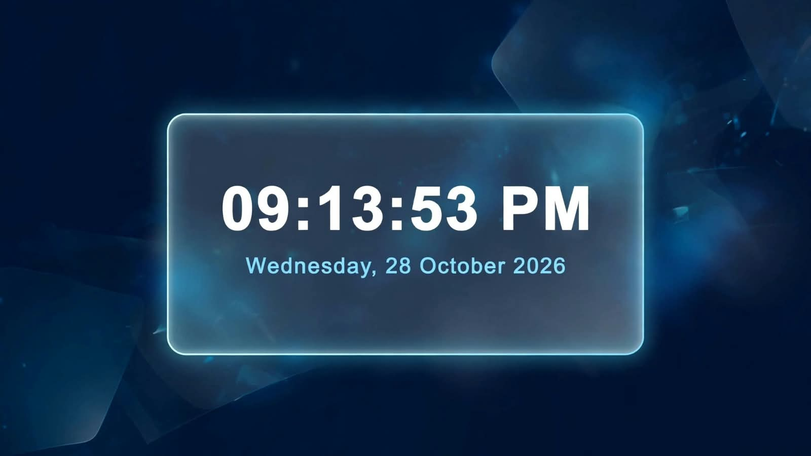

# 🕒 Digital Clock

> A modern, real-time digital clock with a sleek glassmorphism UI.


### ✨ Live Demo
> [Click here to view live](https://hiba-sarwar07.github.io/Digital-Clock/)

### 📸 Preview


### 🚀 Features
- ⏰ Real-time hours, minutes, seconds
- 📅 Current date and day display
- 🌗 AM / PM format
- 🎨 Glassmorphism + Animated gradient background
- 📱 Fully responsive for mobile & desktop
- ⚡ No frameworks - Pure HTML, CSS, JS

### 🛠️ Built With
- **HTML5** - Structure
- **CSS3** - Glassmorphism, Animations, Flexbox
- **JavaScript** - `setInterval()` for real-time clock logic

### 💻 How to Run Locally
```bash
# 1. Clone the repo
git clone https://github.com
